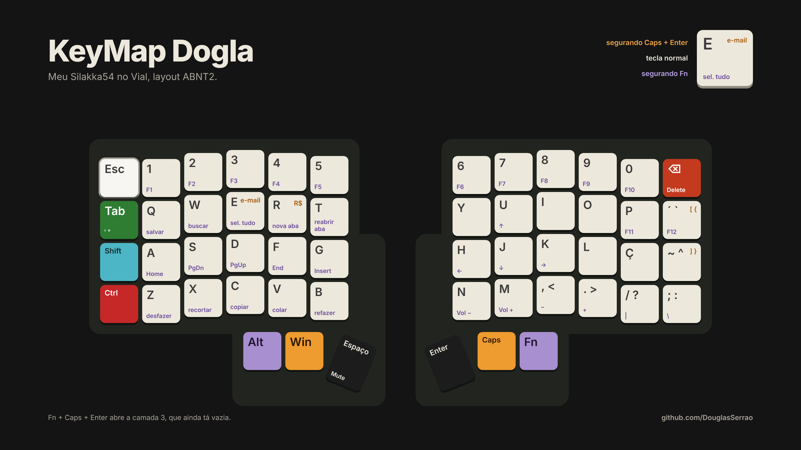

# KeyMap Dogla

Esse é o keymap do meu Silakka54, um teclado split que eu configuro pelo Vial, no layout ABNT2.

No polegar direito ficam Enter, Caps Lock e Fn, de dentro pra fora. Segurando o Fn vai pra camada 1 (em roxo no mapa). Segurando Caps Lock + Enter vai pra camada de símbolos (em laranja), onde o acento agudo e o til viram [ { e ] }, e onde ficam as macros. A camada 3 ainda tá vazia.

Pra usar no seu, abre o Vial, vai em File > Load saved layout e escolhe o arquivo que tá na pasta Vial. A macro de e-mail tá vazia aqui, então grava o seu nela se quiser.

O wallpaper animado da versão 3 fica em `Wallpaper Engine/KeyMap Dogla v3`. É só copiar a pasta pra `wallpaper_engine\projects\myprojects`. As versões antigas do mapa e do wallpaper continuam aqui no repositório.
